# care-transitions-agent

Local, privacy-preserving AI for the 30 days after a hospital discharge, built for primary care practices and MSOs.
Every output is a suggestion: a coordinator or provider approves it before anything reaches a patient.

- **Care-transitions agent:** a fixed-order LangGraph workflow. It scores readmission risk (LACE + an under-65
  flag), plans follow-up with deterministic rules (risk tier, TCM 99495/99496 clocks, check-ins), drafts the
  coordinator's call script and the provider's brief with a local LLM, checks the drafts against the record, and
  waits for human review.
- **Discharge-summary extractor:** turns a discharge summary into structured JSON (diagnoses, medication changes,
  follow-up, pending tests, red flags). It's evaluated zero-shot, few-shot, and after QLoRA fine-tuning.

```mermaid
flowchart LR
  A[Payer discharge file] --> B[ingest]
  B --> C[ehr_context<br/>problems, meds]
  C --> D[score<br/>LACE + under-65]
  D --> E[extract<br/>local model, optional]
  E --> F[plan<br/>tier, TCM clocks, check-ins]
  F --> G[draft<br/>call script + brief]
  G --> H{{human review<br/>approve / edit / reject}}
  H --> I[track<br/>SQLite outcomes]
  I -. daily job .-> J[check-ins due]
```



## Design choices (see `docs/adr`)
- **Fixed graph, narrow LLM jobs.** Small local models don't choose tools. Scores, tiers and deadlines are
  deterministic code. Every LLM output is schema-validated, retried once, then flagged for a human (ADR 0002).
- **Grounding check.** A medication or condition named in a draft must exist in the patient's record, or the
  draft is flagged.
- **Local only.** Ollama on this machine. The code refuses cloud models (`-cloud` tags), remote endpoints and
  LangSmith tracing. A GPU-vs-CPU benchmark checks whether a practice without a GPU can run the morning batch
  (ADR 0004).
- **LACE, not a black box.** In the author's payer-notification study, ML did not beat LACE, so the agent uses
  LACE plus an under-65 flag (ADR 0003).

## Data policy
- **Public track (this repo):** Synthea synthetic patients only, including the committed benchmark notes and
  draft samples.
- **Research track (local only):** fine-tuning and evaluation on MIMIC-IV-Note under the PhysioNet credentialed
  license. No MIMIC data, note text or MIMIC-trained weights are in this repository, and no MIMIC text is ever
  sent to a cloud service, AI assistants included (ADR 0001). CI fails if data files or weights are tracked.

## Run it
```
uv sync --group dev
uv run pytest                                          # keyless: models are stubbed
ollama pull qwen3:14b
uv run python -m ctagent cohort                        # Synthea discharge cohort
uv run python -m ctagent demo --n 10                   # morning batch -> review queue
uv run streamlit run app/review_app.py -- --workspace data/demo
uv run python -m ctagent bench --model qwen3:14b [--cpu]
uv run python -m ctagent extract-bench --mode few --model qwen3:8b
```

Results live in `evals/results/` and progress in [PROGRESS.md](PROGRESS.md). Spec: [SPEC.md](SPEC.md).

_Synthea results show that the workflow works. They are not evidence of clinical validity (ADR 0005)._
