# care-transitions-agent

[](https://doi.org/10.5281/zenodo.24090449)

Local, privacy-preserving AI for the 30 days after a hospital discharge, built for primary care practices and MSOs.
Every output is a suggestion: a coordinator or provider approves it before anything reaches a patient.

**Research code.** It has not been validated for clinical use or used in patient care, and it should not be
used in patient care without local validation, human review of every output and the practice's own approvals
(paper, Code availability).

**Paper (preprint):** [From discharge alerts to follow-up work: design and retrospective evaluation of a local,
human-in-the-loop AI agent for primary care](https://doi.org/10.5281/zenodo.24090449). Zenodo, 2026.
doi:10.5281/zenodo.24090449

- **Care-transitions agent:** a fixed-order LangGraph workflow. It scores readmission risk (LACE plus a flag for
  Medicare coverage under 65), plans follow-up with deterministic rules (risk tier, TCM 99495/99496 clocks,
  check-ins), drafts the coordinator's call script and the provider's brief with a local LLM, checks the drafts
  against the record, and waits for human review.
- **Discharge-summary extractor:** turns a discharge summary into structured JSON (diagnoses, medication changes,
  follow-up, pending tests, red flags). It's evaluated zero-shot, few-shot, and after QLoRA fine-tuning.

```mermaid
flowchart LR
  A[Payer discharge file] --> B[ingest]
  B --> C[ehr_context<br/>problems, meds]
  C --> D[score<br/>LACE + Medicare under 65]
  D --> E[extract<br/>local model, optional]
  E --> F[plan<br/>tier, TCM clocks, check-ins]
  F --> G[draft<br/>call script + brief]
  G --> H{{human review<br/>approve / edit / reject}}
  H --> I[track<br/>SQLite outcomes]
  I -. daily job .-> J[check-ins due]
```



## Results (paper: [paper/manuscript.pdf](paper/manuscript.pdf); details in [PROGRESS.md](PROGRESS.md))
- **Risk tiers on MIMIC-IV** (64,036 stays): the high tier flags 38.2% of stays, whose 30-day readmission rate
  is 28.3%, against 14.3% for the rest. LACE AUROC is 0.638 (0.631-0.646).
- **Extraction on MIMIC-IV-Note:**
  - Against the author-corrected diagnosis reference (51 notes, corrected from the rule-generated labels),
    fine-tuned Qwen3-8B scores micro F1 0.93-0.94, about the rules' own 0.93, against 0.69-0.72 for prompted
    models zero-shot and 0.81-0.85 few-shot.
  - Across all fields (200 notes, a model-made reference), prompted models lead: 0.70-0.72 zero-shot and
    0.67-0.68 few-shot. The fine-tunes (0.58-0.60) perform at the level of the rule-generated labels themselves
    (0.58). Fine-tuning transferred the rules, gaps and potential errors included.
  - So a prompted base model is the preferred default extractor; fine-tuning is worth it only for fields
    whose labels were checked against a reference other than the training labels (here, the section-based
    diagnoses).
- **Drafts on 195 MIMIC discharges** (qwen3:14b, one RTX 4080):
  - 16.8 s per discharge, and no document still failed validation after the retry
  - every medication name in the drafts matched a record stand-in that included the model's own extraction, and
    98.4% also appeared in the note text
  - 93.6% of the extracted changed medications (started, stopped or dose changed) are named in the provider
    brief
- **Synthetic benchmark** (107 notes with known answers, micro F1, paper Table 4): rules 0.696, base Qwen3-8B
  zero-shot 0.948 (Base-8B-local), Qwen3-8B few-shot 0.966, Qwen3-14B few-shot 0.979.
- The MIMIC-trained weights are not distributed ([model card](docs/MODEL_CARD.md)).

## Design choices (see `docs/adr`)
- **Fixed graph, narrow LLM jobs.** Small local models don't choose tools. Scores, tiers and deadlines are
  deterministic code. Every LLM output is schema-validated, retried once, then flagged for a human (ADR 0002).
- **Grounding check.** A medication or condition named in a draft must exist in the patient's record, or the
  draft is flagged.
- **Local only.** Ollama on this machine. The code refuses cloud models (`-cloud` tags), remote endpoints and
  LangSmith tracing. A GPU-vs-CPU benchmark checks whether a practice without a GPU can run the morning batch
  (ADR 0004).
- **LACE, not a black box.** LACE is a published, transparent score that needs no local training data (paper
  Section 2.1). The provisional lower threshold, LACE >= 7 with Medicare coverage under 65, was informed by the
  author's earlier, unpublished analysis of payer notifications, which is outside the paper (ADRs 0003, 0005).

## Data policy
- **Public track (this repo):** Synthea synthetic patients only, including the committed benchmark notes and
  draft samples.
- **Research track (local only):** fine-tuning and evaluation on MIMIC-IV-Note under the PhysioNet credentialed
  license. No MIMIC data, note text or MIMIC-trained weights are in this repository, and every model that is
  trained or evaluated runs locally. One exception to keeping note text on this machine: on
  2026-11-01, Claude Opus 5.5 (Anthropic), a cloud service, used through its browser extension with model
  training turned off, read the 200 evaluation notes in the local annotation tool and corrected their
  pre-filled labels, making a second, model-made reference. This was the only step in which note text
  left this machine. PhysioNet's guidance on online services lists Anthropic Claude among the services it
  suggests for credentialed data. See [ADR 0001](docs/adr/0001-two-track-data-policy.md) and
  [docs/ANNOTATION.md](docs/ANNOTATION.md).
- CI fails if a tracked file has a data or weight file type, is a `.env` file at any depth, or matches
  `.gitignore`.

## Run it
```
uv sync --group dev
uv run pytest                                          # keyless: models are stubbed
ollama pull qwen3:14b
ollama pull qwen3:8b
# Synthea's CSV output is not in this repo. Make it once with Synthea commit d9d07a6 (Java 17+), next to this
# clone, with the settings and seeds in synthetic/synthea/portfolio.properties (Windows: run_synthea.bat):
git clone https://github.com/synthetichealth/synthea.git ../_synthea
git -C ../_synthea checkout d9d07a6
cp synthetic/synthea/portfolio.properties ../_synthea/
(cd ../_synthea && ./run_synthea -c portfolio.properties -s 20260830 -cs 1788128736677 -r 20260830 \
  -e 20260830 -p 2000 -a 65-95 Florida)
# run_synthea takes dates to the day, so counts can differ slightly from PROGRESS.md (743 Medicare index stays)
# cohort, demo and bench read ../_synthea/output/csv; --synthea <dir> or SYNTHEA_CSV_DIR (.env) points elsewhere
uv run python -m ctagent cohort                        # Synthea discharge cohort
uv run python -m ctagent demo --n 10                   # morning batch -> review queue
uv run streamlit run app/review_app.py -- --workspace data/demo
uv run python -m ctagent pilot-report --workspace data/demo   # review, timeliness and outcome measures
uv run python -m ctagent bench --model qwen3:14b --n 30   # Table 8 GPU row; CPU row: add --cpu, use --n 5
uv run python -m ctagent extract-bench --mode few --model qwen3:8b
uv run python -m ctagent gold-demo --n 10 --overlap 3     # synthetic practice set
uv run streamlit run app/annotate_app.py -- --gold-dir data/gold-demo   # gold-set annotation screen
```

`uv run pytest`, `extract-bench`, `gold-demo` and the annotation screen need no Synthea output. `bench` and
`extract-bench` write to `evals/results/`, replacing the committed result files.

Results live in `evals/results/` and progress in [PROGRESS.md](PROGRESS.md). Spec: [SPEC.md](SPEC.md).

_Synthea results show that the workflow works. They are not evidence of clinical validity (ADR 0005)._

## License
The code is under the [MIT License](LICENSE). The paper ([paper/manuscript.md](paper/manuscript.md),
[paper/manuscript.pdf](paper/manuscript.pdf)) and its figures are under
[CC BY 4.0](https://creativecommons.org/licenses/by/4.0/), as on Zenodo
([doi:10.5281/zenodo.24090449](https://doi.org/10.5281/zenodo.24090449)). The build scripts in `paper/`
(`build_pdf.py`, `figure1.py`) are code, under the MIT License.
