# care-transitions-agent

[](https://doi.org/10.5281/zenodo.24090449)

Local, privacy-preserving AI for the 30 days after a hospital discharge, built for primary care practices and MSOs.
Every output is a suggestion: a coordinator or provider approves it before anything reaches a patient.

**Paper (preprint):** [From discharge alerts to follow-up work: design and retrospective evaluation of a local,
human-in-the-loop AI agent for primary care](https://doi.org/10.5281/zenodo.24090449). Zenodo, 2026.
doi:10.5281/zenodo.24090449

- **Care-transitions agent:** a fixed-order LangGraph workflow. It scores readmission risk (LACE + an under-65
  flag), plans follow-up with deterministic rules (risk tier, TCM 99495/99496 clocks, check-ins), drafts the
  coordinator's call script and the provider's brief with a local LLM, checks the drafts against the record, and
  waits for human review.
- **Discharge-summary extractor:** turns a discharge summary into structured JSON (diagnoses, medication changes,
  follow-up, pending tests, red flags). It's evaluated zero-shot, few-shot, and after QLoRA fine-tuning.

```mermaid
flowchart LR
  A[Payer discharge file] --> B[ingest]
  B --> C[ehr_context<br/>problems, meds]
  C --> D[score<br/>LACE + under-65]
  D --> E[extract<br/>local model, optional]
  E --> F[plan<br/>tier, TCM clocks, check-ins]
  F --> G[draft<br/>call script + brief]
  G --> H{{human review<br/>approve / edit / reject}}
  H --> I[track<br/>SQLite outcomes]
  I -. daily job .-> J[check-ins due]
```



## Results (paper: [paper/manuscript.pdf](paper/manuscript.pdf); details in [PROGRESS.md](PROGRESS.md))
- **Risk tiers on MIMIC-IV** (64,036 stays): the high tier flags 38.2% of stays, whose 30-day readmission rate
  is 28.3%, against 14.3% for the rest. LACE AUROC is 0.638 (0.631-0.646).
- **Extraction on MIMIC-IV-Note:**
  - Against hand labels (51 notes, diagnoses), fine-tuned Qwen3-8B scores micro F1 0.93-0.94, against
    0.69-0.72 for prompted models.
  - Across all fields (200 notes, a model-made reference), prompted models lead (0.70-0.72), and the fine-tunes
    perform at the level of their rule-based training labels (0.58-0.60). Fine-tuning transferred the rules,
    errors and gaps included.
- **Drafts on 195 MIMIC discharges** (qwen3:14b, one RTX 4080):
  - 16.8 s per discharge, with no validation failures and no medication absent from the record
  - 93.6% of the extracted medication changes reach the provider brief
- **Synthetic benchmark** (107 notes with known answers, micro F1): rules 0.696, qwen3:8b zero-shot 0.947,
  qwen3:14b few-shot 0.979.
- The MIMIC-trained weights are not distributed ([model card](docs/MODEL_CARD.md)).

## Design choices (see `docs/adr`)
- **Fixed graph, narrow LLM jobs.** Small local models don't choose tools. Scores, tiers and deadlines are
  deterministic code. Every LLM output is schema-validated, retried once, then flagged for a human (ADR 0002).
- **Grounding check.** A medication or condition named in a draft must exist in the patient's record, or the
  draft is flagged.
- **Local only.** Ollama on this machine. The code refuses cloud models (`-cloud` tags), remote endpoints and
  LangSmith tracing. A GPU-vs-CPU benchmark checks whether a practice without a GPU can run the morning batch
  (ADR 0004).
- **LACE, not a black box.** In the author's payer-notification study, ML did not beat LACE, so the agent uses
  LACE plus an under-65 flag (ADR 0003).

## Data policy
- **Public track (this repo):** Synthea synthetic patients only, including the committed benchmark notes and
  draft samples.
- **Research track (local only):** fine-tuning and evaluation on MIMIC-IV-Note under the PhysioNet credentialed
  license. No MIMIC data, note text or MIMIC-trained weights are in this repository (ADR 0001). Every model
  that is trained or evaluated runs locally. One exception: the 200 gold-set notes were labeled with Claude to
  make a second reference ([docs/ANNOTATION.md](docs/ANNOTATION.md)). CI fails if data files or weights are
  tracked.

## Run it
```
uv sync --group dev
uv run pytest                                          # keyless: models are stubbed
ollama pull qwen3:14b
uv run python -m ctagent cohort                        # Synthea discharge cohort
uv run python -m ctagent demo --n 10                   # morning batch -> review queue
uv run streamlit run app/review_app.py -- --workspace data/demo
uv run python -m ctagent pilot-report --workspace data/demo   # review, timeliness and outcome measures
uv run python -m ctagent bench --model qwen3:14b [--cpu]
uv run python -m ctagent extract-bench --mode few --model qwen3:8b
uv run python -m ctagent gold-demo --n 10 --overlap 3     # synthetic practice set
uv run streamlit run app/annotate_app.py -- --gold-dir data/gold-demo   # gold-set annotation screen
```

Results live in `evals/results/` and progress in [PROGRESS.md](PROGRESS.md). Spec: [SPEC.md](SPEC.md).

_Synthea results show that the workflow works. They are not evidence of clinical validity (ADR 0005)._
