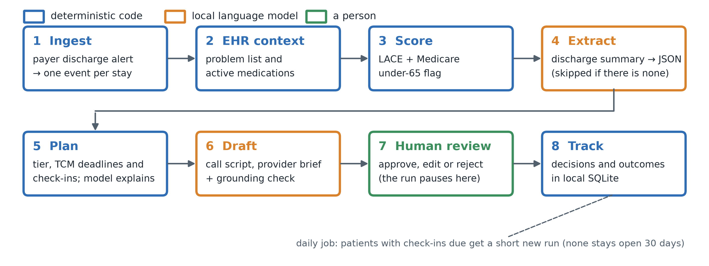

# From discharge alerts to follow-up work: design and retrospective evaluation of a local, human-in-the-loop AI agent for primary care

**Thiago Batista Nunes Bandeira**, ORCID https://orcid.org/0009-0006-0204-5298

Mendez Medical Center, 5950 W. Oakland Park Blvd, 3rd Floor, Lauderhill, FL 33313, USA
(https://mendezmedicalcenter.com). Correspondence: thiagobandeira.ai@gmail.com

---

## Abstract

**Objective.** Primary care practices learn about their patients' hospital discharges from payer alerts, but
turning each alert into timely follow-up is manual work, and the hospital's discharge summary often does not reach
the practice. We designed an AI agent that runs on a practice's own hardware and evaluated its components
retrospectively on de-identified hospital data.

**Materials and Methods.** For each discharge, deterministic code scores readmission risk (LACE) and sets the
follow-up dates. A local language model extracts structured facts from the discharge summary, when one exists,
and drafts a coordinator call script and a provider brief; by design a person approves them, and this evaluation
stopped before that step. On MIMIC-IV, we evaluated the risk tiers against 30-day unplanned readmission (an
admission-type proxy) in 64,036 stays; extraction in 200 discharge summaries, comparing prompted Qwen3 8B and 14B
models with QLoRA fine-tunes trained on rule-generated or teacher labels; and drafting in 195 discharges, with
automated checks. Both extraction references started from the rule-generated labels: an author-corrected diagnosis
reference (51 notes) and a language-model-corrected reference for all fields (200 notes).

**Results.** High-risk discharges were readmitted about twice as often as the rest (28.3% against 14.3%; area
under the receiver operating characteristic curve [AUROC] for LACE, 0.638). Against the diagnosis reference, the fine-tuned models scored highest (micro F1 0.93-0.94, against
0.69-0.72 for prompted models zero-shot). Against the all-field reference, prompted models zero-shot scored
0.70-0.72 and the fine-tunes 0.58-0.60, similar to the rule-generated labels themselves (0.58), and the fine-tunes
matched 243-299 of the rules' 301 potentially false "started" medications (by note and drug-name key), against
22-46 for prompted models. Drafting took 16.8 s per discharge on one consumer GPU; every medication name in the drafts
matched a record stand-in that included the model's own extraction, and 98.4% also appeared in the note text.

**Discussion.** Deterministic rules can carry the time-critical scheduling while small local models handle text.
Fine-tuning on rule-generated labels reproduced the labels' gaps and potential errors, and evaluation against those
same labels concealed it.

**Conclusion.** A local, human-in-the-loop follow-up agent is computationally feasible on commodity hardware. On
these benchmarks a prompted base model was the better default extractor; fine-tuning should be limited to fields
whose labels have been checked against a reference other than the training labels. Human review, the clinical
accuracy of the drafts and operational benefit remain to be evaluated, and the agent has not been used in patient
care.

---

## 1. Introduction

After a hospital stay, the primary care team has to act on what happened. It contacts the patient, reconciles
medications, schedules a visit, follows up on results still pending, and watches for warning signs. Discharge
information often reaches primary care late or incomplete,¹ and adverse events after discharge are common, many
of them related to medications.² In the United States, transitional care management (TCM) adds requirements: an
interactive contact within two business days of discharge, medication reconciliation by the face-to-face visit,
and that visit within 7 days with high-complexity medical decision making (Current Procedural Terminology [CPT] code 99496) or within 14 days with at
least moderate complexity (99495).³

Many practices learn about discharges from payer encounter notifications, daily alerts that list which of their
patients were admitted or discharged. An alert is not follow-up work. Someone still has to decide who is at high
risk, what is due by when, what the hospital changed, and what to say on the phone. In a small practice, this work
often falls to one coordinator working through the list by hand.

Large language models (LLMs) can extract clinical information and draft text,⁴ and agent systems chain such steps
together. Three constraints matter in small practices. Sending patient notes to a cloud service raises
privacy and contractual questions. Open-weight models small enough to run on a single consumer GPU are weaker
than the largest cloud models. And autonomous agents that choose their own actions are hard to make safe and
auditable in clinical work.

We designed a care-transitions agent around these constraints: a fixed workflow, deterministic code for every
rule-based decision, small local models only for reading and writing text, and a required human approval step.
The work aims to help primary care practices adopt such tools on hardware they already own, so the code, the
synthetic benchmark and every aggregate result are open. This paper describes the agent and evaluates its
components retrospectively on de-identified hospital data: the risk tiers, extraction and drafting. It also examines a
question that arose while building it: what a small local model learns when it is fine-tuned on cheap,
rule-generated labels, compared with prompting the same model. Human review and use were not evaluated.

## 2. Materials and methods

### 2.1 The agent

The agent runs one short, fixed-order workflow per discharge (Figure 1), built with LangGraph. Deterministic code
makes every rule-based decision. The language model has narrow jobs inside specific steps and never chooses
actions or tools.

**Figure 1.** One run per discharge alert, in a fixed order. Blue steps are deterministic code, orange steps use
a local language model, and the green step is a person. Plan is rule-based; the model only writes a short
explanation of the plan. Extraction is skipped when no discharge summary is available. A daily job starts a short
new run for each patient with a check-in due, so no run stays open for the 30 days. This study evaluated steps 3,
4 and 6, and the workflow up to the review pause.

The workflow has eight steps. **Ingest** normalizes the day's payer discharge file to one event per stay, with
dates, age, disposition, acuity and prior use. **EHR context** retrieves active problems and medications from the
practice's electronic health record (EHR). **Score** computes the LACE index⁵ (length of stay, acuity of admission, Charlson comorbidity,
and emergency visits in the prior six months). It also flags Medicare coverage at an age under 65, a group that
includes people entitled through disability or end-stage renal disease. High risk means LACE ≥ 10, or LACE ≥ 7
with Medicare coverage under 65. The lower threshold is a provisional policy rule informed by the author's earlier,
unpublished analysis of payer notifications at the author's practice, which is outside this study; it is not a
validated cutoff, and both thresholds are to be calibrated on each practice's outcomes. LACE is a
published, transparent score that needs no local training data. **Extract**, when a discharge summary is
available, has a local model turn it into structured JSON: principal and secondary diagnoses, medication changes,
follow-up appointments, pending tests and red-flag symptoms. **Plan** applies the rules in Table 1 and has the
model write a two-to-three-sentence explanation for the coordinator. The risk tier sets the practice's scheduling
targets, including which TCM face-to-face window the plan tracks: the 7-day window that applies if the visit is
billed as 99496 for high-risk patients, and the 14-day window that applies if it is billed as 99495 for the others.
Tracking the shorter window for high-risk patients is a conservative scheduling default. The plan stores the code
that goes with the tracked window; the review screen labels it a candidate only, and the drafting prompt receives
it as context. A LACE tier is not a measure of medical decision making: the code billed depends on the provider's
documented medical decision making, which the agent does not assess, and the agent assigns and submits no billing
codes. **Draft** has the model write a coordinator call script
(opening, questions, medication review, warning signs, scheduling) and a one-page provider brief (reason for
admission, key conditions, medication changes, what to watch for, risk summary). A deterministic check then flags
any medication or condition a draft names that is not in the patient's record. **Human review** pauses the run,
with its state saved in a local SQLite checkpointer, until a coordinator or provider approves, edits or rejects
the drafts; by design, nothing reaches a patient or the record without that decision. **Track** stores decisions
and outcomes locally.

**Table 1.** The follow-up plan's rules. Visit targets and check-ins are the practice's scheduling rules. The TCM
window is a reminder of a billing requirement, not a billing decision.

| | High risk | Standard |
|---|---|---|
| Tier (provisional) | LACE ≥ 10, or ≥ 7 with Medicare under 65 | all other discharges |
| Interactive contact (TCM requirement for both codes) | within 2 business days | within 2 business days |
| Visit target (practice scheduling rule) | within 3 days | within 7 days |
| TCM face-to-face window the plan tracks | 7 days (applies if billed as 99496) | 14 days (applies if billed as 99495) |
| Check-ins (practice rule) | days 10 and 20 | none |

Every model output is validated against a schema and retried once. A second failure falls back to the rule
text, or to an empty value, and flags the case for a person. Drafts have length limits, and a list that repeats
an item is rejected as a runaway generation. The code refuses cloud model tags, remote endpoints and hosted
tracing; models are served locally by Ollama. The review screen can time each review and record how much of each
draft was edited and whether flags were real problems; these measures were not used in this study.

### 2.2 Data

**MIMIC.** We used the Medical Information Mart for Intensive Care (MIMIC): the discharge summaries of MIMIC-IV-Note v2.2⁶,⁷ (331,793 notes from 145,914 patients, 2008-2019) and the
hospital module of MIMIC-IV v3.1⁶,⁸ (patients admitted 2008-2022), both from the Beth Israel Deaconess Medical Center in
Boston, on PhysioNet.⁹ Notes were split by patient into training, validation and test
sets (70/10/20, seed 13), so no patient appears in two splits. The 200 evaluation notes were a random sample of
the test split (seed 21) and came from 200 different patients; the 51 hand-labeled notes were the first 51 in
sampling order. The model reads seven sections of each summary in a fixed order: discharge
diagnosis, admission medications, discharge medications, discharge instructions, follow-up instructions, pending
results and hospital course. Inputs are capped at 14,000 characters, which 0.3% reach; the median input is about
1,050 tokens. MIMIC replaces the Follow-up Instructions section with a placeholder, so follow-ups have to come
from other sections.

**Synthetic benchmark.** Qwen3-14B wrote 150 discharge summaries from Synthea patient records.¹⁰ A note was kept
only if it mentioned every reference fact, so every field has a known answer, by construction. The notes are
split by Synthea patient, 43 notes (40 patients) for few-shot examples and 107 (96 patients) for testing, and are
public with the code.

### 2.3 Evaluating the risk tiers

This part evaluates a published score inside the agent's workflow; it does not develop a new prediction model.

**Cohort.** The cohort was every admission with a discharge summary in the test split, excluding deaths in hospital
and discharges to hospice, for which the agent plans no follow-up.

**Outcome.** The primary outcome is an admission-type proxy for unplanned readmission: any later admission of the
same patient anywhere in MIMIC-IV's hospital module (not only the note-linked cohort) that started after the
index discharge time and within 30 × 24 hours of it, with an admission type other than elective or same-day
surgery. A same-day return counts if it starts after discharge; an intervening elective admission neither counts
nor blocks a later unplanned one; the outcome is binary. Follow-up is not censored at the end of a patient's
record, and MIMIC records only its own hospital, so some readmissions are missed. The secondary outcome is death
(from the date of death in the patients table) or readmission within 30 days, LACE's original outcome.

**Score.** LACE as the agent computes it at discharge has four parts. Length of stay (L) counts calendar days from
admission to discharge, scored 0 for less than one day, 1-3 for 1-3 days, 4 for 4-6, 5 for 7-13 and 7 for 14 or more.
Acuity (A) gives 3 points for an emergency, urgent or emergency-observation admission type, or registration in the
emergency department (ED). Comorbidity (C) is the Charlson score from the admission's billing diagnoses, using Quan's
enhanced ICD-9-CM and ICD-10 coding algorithms¹¹ matched by code prefix (ICD-10-CM codes are matched with the ICD-10
prefixes), with severe liver disease, complicated diabetes and metastatic cancer superseding their milder forms; it
is scored as is up to 3, and 5 for 4 or more. Emergency use (E) gives one point per distinct ED registration day
2-182 days before admission (about six months, excluding the index visit), up to 4. MIMIC's hospital module has no
ED-only visits, so these are ED-registered admissions and undercount ED use.

Missing diagnoses or visits score 0. Because billing diagnoses are coded after discharge and ED-only visits are
absent, this is an operationalization of LACE on hospital data, not the score a practice would compute from its
own record at discharge. The Medicare flag came from the admission's insurance.

**Measures.** The measures were the area under the receiver operating characteristic curve (AUROC) of the score; the
share of stays in the high tier, the readmission rate in each tier, and the share of readmissions in the high tier
(sensitivity); and the same measures for LACE ≥ 10 alone. Confidence intervals (95%) come from 1,000 bootstrap
resamples of patients, each resampled patient contributing all of their stays.

### 2.4 Evaluating extraction

**Task.** Every key of the six-field JSON is required, and the prompt states each field's definition and
conventions; without this guidance, zero-shot models skipped whole fields in early experiments on the synthetic
notes. A note whose answer still fails validation after the retry counts as an empty prediction. Repeated list
items are dropped before scoring, in predictions and references alike.

**Training labels.** Rule-generated "silver" labels come from each note's own structure. Diagnoses come from the
Discharge Diagnosis section: the first line is the principal diagnosis and the rest are secondary (a principal
diagnosis is found in 95.9% of notes). Medication changes compare the numbered or bulleted admission and
discharge lists by drug name and dose: `started` if only on the discharge list, `stopped` if only on the
admission list, and otherwise `dose_changed` or `continued`. Follow-ups come from the redacted section, so silver
has none; pending tests are sentences containing "pending"; red flags are the list after phrases such as "call
your doctor". As an alternative, Qwen3-14B with three training examples (the few-shot setting below) labeled
follow-up, pending tests and red flags for 2,500 training and 300 validation notes (11.2 s per note, about 9 GPU
hours), while diagnoses and medication changes stayed silver. This teacher listed follow-ups in 40% of notes,
pending tests in 19% and red flags in 74%.

**Models.** We prompted Qwen3-8B and Qwen3-14B¹² zero-shot and with three fixed training examples, served by
Ollama in 4-bit (Q4_K_M) with greedy decoding, a 16,384-token context and a 3,000-token answer cap. We fine-tuned
Qwen3-8B with quantized low-rank adaptation (QLoRA)¹³,¹⁴: a 4-bit NF4 base, LoRA rank 16 (alpha 32) on all linear layers, one epoch at learning
rate 2e-4 with cosine decay, an effective batch of 8, and loss on the answer only, using the zero-shot prompt.
Examples longer than 3,072 tokens were dropped rather than truncated, keeping about 89% of notes. We trained four
models (Table 2). Each adapter was merged, converted to GGUF with llama.cpp, quantized to Q4_K_M (5.0 GB) and
served like the base models. The untouched base model went through the same conversion as a quantization control
(Base-8B-local); its micro F1 was within 0.001 of the Ollama library build's (qwen3:8b) on the synthetic notes and the 200-note
reference, and 0.022 higher on the 51-note reference. Appendix A gives the remaining
settings: seeds, sampling, model identifiers, decoding and training details.

**Table 2.** The fine-tuned models.

| Model | Training labels | Training notes |
|---|---|---|
| Silver-8851 | silver | 8,851 (of 10,000 sampled; 4.4 h) |
| Silver-2500 | silver | 2,500 (71 min) |
| Teacher-2500 | teacher for follow-up, pending tests and red flags; silver for the rest | the same 2,500 (74 min) |
| Teacher-1250 | as Teacher-2500 | the first 1,250 of them (37 min) |

**References.** Training labels cannot serve as the reference, because a model trained on them is rewarded for
imitation. We built two references on the 200 test notes in a local annotation tool that shows the note beside
the silver labels as editable tables and saves only answers that pass the schema. Both references were therefore
initialized from the silver labels: they are distinct from the training labels, but not independent of the rules
that produced them.

**Author-corrected diagnosis reference.** The author, whose training is in data science and AI and who has five
years of experience supervising clinical and operational work in primary care, corrected 51 notes (median 0.3
minutes per note) following a written guideline published with the code. Under it, the principal diagnosis is the
main reason for the hospitalization as written under Discharge Diagnosis (the first or "primary" one), and secondary
diagnoses are the other diagnoses listed there; past history not listed at discharge, and diagnoses mentioned only
elsewhere in the note, are out of scope. This reference covers the two diagnosis fields only. Follow-up, pending
tests and red flags were left out before labeling, as too ambiguous for a quick single pass. Medication changes were
labeled, then excluded after a check found a systematic error in them (Section 3.2); this decision was made after
the hand pass and before any model was scored against the hand labels.

**Language-model-corrected reference.** Claude Opus 5.5 (Anthropic), a cloud service, filled in all six fields on
all 200 notes on 1 November 2026, by operating the same tool through its browser extension under the author's
account, whose model-training setting ("Help improve Claude") was turned off at the time (median 0.5 minutes per
note). PhysioNet's guidance on online services lists Anthropic Claude among the services it suggests for credentialed
data, noting that Claude does not train on prompts or responses by default and does not routinely have humans
review data.¹⁵ This was the only step in which note text left the local machine; every evaluated model, and every other
step, ran locally. We treat these labels as model-made, not as hand annotation.

**Metrics.** List fields are scored as sets, with greedy pairing. A match is exact (normalized equality) or
relaxed (token Jaccard overlap of at least 0.5); relaxed is the primary metric. A medication change matches only
when the drug name and the change type both match, and change-type accuracy among matched drug names is reported
separately. True positives, false positives and false negatives are summed over notes, and micro F1 pools the
fields each reference covers; because medication entries make up 62% of the language-model-corrected reference's items, we
also report the macro average over fields. Appendix A gives the normalization and pairing rules. Confidence intervals
come from 1,000 bootstrap resamples of patients, each drawn patient contributing all of their notes; on MIMIC the 200
and 51 evaluation notes each come from a different patient, and on the synthetic notes 11 of the 96 test patients
contribute two notes. For the comparisons the conclusions rest on, we report paired
bootstrap differences (2,000 resamples of patients). All intervals are conditional on the fitted models and the
reference labels; they do not capture annotation error, training-seed variability or the choice of prompts.
Predictions were generated once and rescored against each reference.

### 2.5 Evaluating the drafts

On synthetic patients, the full workflow ran without a discharge summary, so extraction was skipped and the drafts
came from the Synthea record alone: on 30 Synthea discharges with Qwen3-14B and Qwen3-8B on the GPU, and on 5
discharges with GPU offload disabled. Drafting used the Qwen3 model card's recommended non-thinking sampling
with a fixed seed, because greedy decoding caused repetition loops in drafts.

On MIMIC, the full workflow ran up to the review pause on the 200 test notes. Five patients who died or went to
hospice were skipped, leaving 195 discharges. Each discharge event came from the hospital module (times, age,
disposition, acuity, prior emergency visits and Medicare), and the record stand-in held the admission's billing
diagnoses plus the diagnoses and medications from the note's extraction. Extraction used the saved Qwen3-14B
zero-shot predictions, and the same model drafted, so one model stays loaded.

This is a development evaluation, not an untouched test. The extractor was chosen as the best overall on the
same 200 notes (Table 6), and the drafting prompt was revised after a first run on the same 195 discharges: the
first run showed long condition lists and occasional validation failures, so the final prompt asks the brief for
at most six conditions, most important first, and forbids placeholders such as "[Your Name]". We report both runs.
The extraction prompt and its field guidance were developed on the synthetic notes, and all few-shot examples come
from training splits. A further 30 synthetic discharges, sampled separately (one overlaps the 30 above), were
drafted with the practice's name in the prompt to check placeholders.

We measured by automated counts only, and no MIMIC draft was read; in the synthetic runs, the one flagged item
was inspected. Record grounding is the agent's own check against the
record, which includes the model's extraction, so a draft can repeat an extraction error and still pass it. Note
grounding counts the medication names in the drafts that appear in the note text (the whole name, or every word of
four or more letters in it), and the conditions in the brief that share at least one content word with the note,
a permissive test. Completeness, measured against the extraction, counts the changed medications (started,
stopped or dose changed) named in the brief, with the same change type, and in the call script, and the red flags
covered by a warning sign in the call script (one sign holding at least half of the flag's content words). None of
these checks assesses dose, timing, negation or clinical correctness. Seconds per discharge are wall-clock time for
the three model calls, retries included, with the model already loaded except for the first discharge of a run.

### 2.6 Hardware and software

All local work (inference, fine-tuning and analyses) ran on one NVIDIA RTX 4080 (16 GB), an Intel i9-14900K CPU and
64 GB of RAM, under Windows. The agent uses Python 3.12.10, LangGraph 1.2.17 with langgraph-checkpoint-sqlite
3.1.2, LangChain Core 1.7.0, langchain-ollama 1.1.0, Pydantic 2.14.1 and Streamlit 1.66.1, with models served by
Ollama 0.40.13. Fine-tuning used PyTorch 2.11.0 (CUDA 12.8), Transformers 5.20.2, TRL 1.16.0, PEFT 0.21.2,
bitsandbytes 0.50.2 and Accelerate 1.15.0; conversion used llama.cpp release b11921. Analyses used pandas 3.1.0 and
NumPy 2.5.4, and the figure matplotlib 3.11.2.

### 2.7 Ethics

The Institutional Review Board at the Beth Israel Deaconess Medical Center (Boston, Massachusetts, USA) reviewed
the collection of patient information and the creation of the MIMIC-IV and MIMIC-IV-Note research resources,
granted a waiver of informed consent and approved the data sharing initiative.⁶,⁷,⁸ PhysioNet's pages for these
resources give no approval number for that review. Under the waiver, no written patient consent was obtained. The
data are de-identified, and the author accessed them on PhysioNet as a credentialed user, which requires
human-subjects research training and a signed data use agreement. Note text left the local machine only for the
language-model-corrected reference, which a cloud service produced (Section 2.4). This study is a secondary analysis
of these existing data and of synthetic records. It recruited no participants and analyzed no other patient data,
including any from the author's practice. No institutional review was obtained beyond the oversight described above. The agent
has not been used in patient care. No MIMIC data, labels, predictions or drafts are in the public repository, which
holds only code, the synthetic benchmark and aggregate metrics.

### 2.8 Reporting

Appendix C maps this report to the relevant items of TRIPOD+AI¹⁶ (for the risk tiers) and TRIPOD-LLM¹⁷ (for
extraction, fine-tuning and drafting). The study had no registered protocol.

## 3. Results

### 3.1 Risk tiers

The cohort held 64,036 stays from 28,220 patients, after excluding 1,692 deaths in hospital and 671 hospice
discharges. Within 30 days, an unplanned readmission followed 12,601 stays (19.7%) and death followed 1,332.
At least one Charlson condition was present in 71.1% of stays, a prior ED-registered admission in 29.2% and an acute
admission in 80.9%; the median LACE was 8 (interquartile range 6-11).

LACE discriminated modestly, with an AUROC of 0.638 for readmission and 0.654 for death or readmission (Table 3).
The agent's high tier flagged 38.2% of stays; their readmission rate was 28.3%, about twice the standard tier's
14.3%, and the tier contained 55.1% of all readmissions. LACE ≥ 10 alone flagged 34.9% at a similar rate (28.9%)
and contained 51.3%, so the under-65 Medicare rule added 3.3 percentage points of stays and 3.8 of sensitivity.

**Table 3.** The agent's risk tiers on MIMIC-IV, 64,036 stays from 28,220 patients, against 30-day unplanned readmission (admission-type proxy); 95% CIs from a patient bootstrap.

| Measure | Estimate (95% CI) |
|---|---|
| LACE AUROC, 30-day readmission | 0.638 (0.631-0.646) |
| LACE AUROC, 30-day death or readmission | 0.654 (0.647-0.660) |
| Stays in the high tier | 38.2% (37.5-39.0) |
| Readmission rate, high tier | 28.3% (27.5-29.2) |
| Readmission rate, standard tier | 14.3% (13.9-14.7) |
| Readmissions caught by the high tier | 55.1% (53.6-56.6) |
| Stays with LACE ≥ 10 | 34.9% (34.3-35.6) |
| Readmission rate, LACE ≥ 10 | 28.9% (28.0-29.7) |
| Readmissions caught by LACE ≥ 10 | 51.3% (49.9-52.7) |

### 3.2 Extraction

**Synthetic notes: the label source shaped the prose fields.** On notes with known answers (Table 4), the
prompted models scored 0.948-0.979 micro F1 and the rules 0.696. The silver fine-tunes lost most of the base
model's performance on follow-up: Silver-8851 scored 0.057, against 0.771 for the base model through the same
conversion. On the same 2,500 notes, replacing silver with teacher labels raised micro F1 from 0.842 to 0.948 and
follow-up from 0.190 to 0.797. Teacher-2500 had a point estimate similar to the base model's (0.948) and below its
teacher's (0.979), and doubling the teacher-labeled notes from 1,250 to 2,500 gave similar micro F1 (0.949 and
0.948).

**Table 4.** Synthetic benchmark, 107 test notes from 96 patients, relaxed F1 (95% CI for micro F1 from a patient bootstrap).

| Model | Principal | Secondary | Medications | Follow-up | Pending | Red flags | Micro F1 |
|---|---|---|---|---|---|---|---|
| Rules | 1.000 | 0.963 | 0.907 | 0.159 | 0.452 | 0.037 | 0.696 (0.678-0.716) |
| Base-8B-local, zero-shot | 0.939 | 0.982 | 0.961 | 0.771 | 0.958 | 0.994 | 0.948 (0.936-0.959) |
| Qwen3-8B, few-shot | 0.925 | 0.979 | 0.983 | 0.856 | 0.972 | 0.994 | 0.966 (0.956-0.974) |
| Qwen3-14B, few-shot (teacher) | 0.935 | 0.981 | 0.981 | 0.981 | 0.928 | 0.994 | 0.979 (0.969-0.987) |
| Silver-8851 | 1.000 | 0.964 | 0.917 | 0.057 | 0.604 | 0.679 | 0.789 (0.766-0.811) |
| Silver-2500 | 1.000 | 0.963 | 0.942 | 0.190 | 0.609 | 0.902 | 0.842 (0.824-0.862) |
| Teacher-1250 | 1.000 | 0.995 | 0.975 | 0.752 | 0.892 | 0.960 | 0.949 (0.937-0.960) |
| Teacher-2500 | 1.000 | 0.995 | 0.949 | 0.797 | 0.905 | 0.978 | 0.948 (0.934-0.961) |

**MIMIC diagnoses: the fine-tunes agreed best with the section-based reference.** Against the author-corrected
reference (Table 5), the fine-tuned models scored 0.927-0.943 micro F1 on the diagnoses, against 0.695-0.724 for the
prompted models zero-shot and 0.808-0.849 few-shot. The paired difference between Silver-8851 and Qwen3-14B
zero-shot was 0.247 (95% CI 0.145 to 0.362). Between the best of each group, Teacher-1250 and Qwen3-8B few-shot, it
was 0.095 (0.022 to 0.172); this pair was chosen after seeing the results, and the interval does not account for
that choice. The principal diagnosis was easy for every model (0.91-0.98); the gap was in
secondary diagnoses. The prompted models found most of them (recall 0.80-0.88 zero-shot) but listed many that the
reference did not (precision 0.48-0.53), while the fine-tunes kept to the Discharge Diagnosis list (precision
0.87-0.91, recall 0.95-0.99). Under a broader definition, some of the prompted models' extra diagnoses could be
legitimate. On these 51 notes, the rules agreed with this reference at 0.933 micro F1, and the language-model-corrected
labels agreed with it at 0.845. On all 200 notes, the language-model-corrected reference also placed the fine-tunes
above the prompted models zero-shot on secondary diagnoses (0.83-0.84 against 0.70-0.75), but Qwen3-8B few-shot
scored highest there (0.873).

**Table 5.** MIMIC-IV-Note, 51 notes from 51 patients, author-corrected diagnosis reference, relaxed F1 (95% CI for micro F1). The last row counts the reference items.

| Model | Principal | Secondary | Micro F1 |
|---|---|---|---|
| Rules (silver) | 0.931 | 0.933 | 0.933 (0.889-0.970) |
| Silver-8851 | 0.950 | 0.937 | 0.942 (0.902-0.980) |
| Silver-2500 | 0.931 | 0.925 | 0.927 (0.877-0.970) |
| Teacher-1250 | 0.970 | 0.931 | 0.943 (0.894-0.984) |
| Teacher-2500 | 0.940 | 0.933 | 0.935 (0.891-0.979) |
| Base-8B-local, zero-shot | 0.941 | 0.642 | 0.724 (0.619-0.821) |
| Qwen3-8B, zero-shot | 0.911 | 0.625 | 0.702 (0.583-0.815) |
| Qwen3-8B, few-shot | 0.961 | 0.800 | 0.849 (0.746-0.938) |
| Qwen3-14B, zero-shot | 0.922 | 0.618 | 0.695 (0.580-0.793) |
| Qwen3-14B, few-shot | 0.980 | 0.737 | 0.808 (0.700-0.909) |
| *Reference items* | 51 | 106 | 157 |

**MIMIC, all fields: the fine-tunes scored at the level of their training labels.** Against the
language-model-corrected reference on all six fields (Table 6), the prompted models zero-shot scored highest
(0.703-0.723), while every fine-tune scored 0.583-0.600, against 0.584 for the rules themselves. The paired
difference between Qwen3-14B zero-shot and Silver-8851 was 0.140 (0.108 to 0.173), and between Qwen3-14B zero-shot
and Teacher-2500 0.135 (0.102 to 0.165). The macro average over fields kept the order: 0.609-0.622 for the prompted
models zero-shot, 0.553-0.579 few-shot, 0.427-0.545 for the fine-tunes and 0.408 for the rules. On medication
changes the prompted models reached 0.73-0.78 F1 with 0.85-0.89 change-type accuracy, and the fine-tunes 0.61-0.63
and 0.73-0.75, near the rules' 0.640 and 0.74. The silver fine-tunes never listed a follow-up; the teacher
fine-tunes recovered part of it (0.30) but stayed below the prompted models zero-shot (0.40-0.49), and red flags
showed the same order. Pending tests, with only 44 reference items, were hard for every model (0.10-0.30) and for
the rules (0.08). At most one of 200 notes per model failed validation.

**Table 6.** MIMIC-IV-Note, 200 notes from 200 patients, language-model-corrected reference for all fields, relaxed F1 (95% CI for micro F1) and change-type accuracy among matched drug names. The last row counts the reference items.

| Model | Principal | Secondary | Medications | Follow-up | Pending | Red flags | Micro F1 | Change type acc. |
|---|---|---|---|---|---|---|---|---|
| Rules (silver) | 0.838 | 0.833 | 0.640 | 0.000 | 0.083 | 0.056 | 0.584 (0.548-0.621) | 0.74 |
| Silver-8851 | 0.843 | 0.834 | 0.628 | 0.000 | 0.101 | 0.155 | 0.583 (0.546-0.622) | 0.74 |
| Silver-2500 | 0.833 | 0.827 | 0.634 | 0.000 | 0.102 | 0.318 | 0.593 (0.554-0.630) | 0.75 |
| Teacher-1250 | 0.841 | 0.842 | 0.625 | 0.303 | 0.304 | 0.357 | 0.600 (0.567-0.633) | 0.75 |
| Teacher-2500 | 0.835 | 0.831 | 0.610 | 0.300 | 0.203 | 0.366 | 0.588 (0.550-0.625) | 0.73 |
| Base-8B-local, zero-shot | 0.852 | 0.749 | 0.725 | 0.416 | 0.225 | 0.754 | 0.704 (0.676-0.729) | 0.85 |
| Qwen3-8B, zero-shot | 0.852 | 0.729 | 0.735 | 0.404 | 0.210 | 0.725 | 0.703 (0.672-0.727) | 0.86 |
| Qwen3-8B, few-shot | 0.865 | 0.873 | 0.739 | 0.260 | 0.250 | 0.333 | 0.668 (0.640-0.694) | 0.88 |
| Qwen3-14B, zero-shot | 0.845 | 0.704 | 0.776 | 0.492 | 0.234 | 0.683 | 0.723 (0.698-0.744) | 0.89 |
| Qwen3-14B, few-shot | 0.877 | 0.808 | 0.729 | 0.357 | 0.293 | 0.412 | 0.675 (0.647-0.700) | 0.86 |
| *Reference items* | 200 | 414 | 2,352 | 328 | 44 | 483 | 3,821 | |

**The fine-tunes repeated the rules' potential false starts.** The medication rule marks a drug `started` when it
is not on a numbered admission list. In 22 of the 51 author-corrected notes, the admission section had no numbered
items (18) or was absent (4), so the rule saw no admission drugs. We screened every `started` drug by whether the
first word of four or more letters in its name appears in the note's admission section, a heuristic screen rather
than proof that the drug was taken before admission (Table 7). To compare sources case by case, each flagged row was
keyed by its note and that word; the key can merge different medications that share a first word (two sodium salts,
for example), so a match means agreement under this rule, not verified identity. Of the rules' 1,211 `started`
rows, 304 (25.1%) were flagged, giving 301 keys. Each fine-tune flagged a similar share (25.3-27.3%) and matched most of
the same keys: Silver-8851 matched 299 of the 301, and the other fine-tunes 243-272. The prompted models flagged
3.3-8.7% of their `started` rows and matched 22-46 of the keys, and the language-model-corrected reference flagged
2.6% (18 of 688 rows). The author-corrected labels
still had 84 of 348 rows (24.1%) flagged, against the rules' 90 on the same 51 notes, which is why medication
changes were left out of that reference.

**Table 7.** Potential false starts: `started` medications whose name's first word (four or more letters) appears
in the note's admission-medication section, on the 200 MIMIC-IV-Note notes.

| Source | Started rows | Flagged rows | Share | Rule-flagged note-drug keys matched (of 301) |
|---|---|---|---|---|
| Rules (silver) | 1,211 | 304 | 25.1% | (301) |
| Language-model-corrected reference | 688 | 18 | 2.6% | 12 |
| Silver-8851 | 1,219 | 316 | 25.9% | 299 |
| Silver-2500 | 1,201 | 304 | 25.3% | 265 |
| Teacher-1250 | 1,155 | 294 | 25.5% | 243 |
| Teacher-2500 | 1,222 | 333 | 27.3% | 272 |
| Base-8B-local, zero-shot | 693 | 60 | 8.7% | 42 |
| Qwen3-8B, zero-shot | 701 | 49 | 7.0% | 35 |
| Qwen3-8B, few-shot | 843 | 70 | 8.3% | 46 |
| Qwen3-14B, zero-shot | 765 | 25 | 3.3% | 22 |
| Qwen3-14B, few-shot | 828 | 39 | 4.7% | 35 |

Rows count `started` entries. A key is a note plus the first word of four or more letters in the drug's name, so
flagged rows with the same key count once: the rules' 304 flagged rows give 301 keys. The key can merge different
medications that share a first word, so the last column counts matches under this rule (each source's flagged keys
that are also among the rules' 301), not verified medication identity.

**Scored against their own training labels, the fine-tunes looked best.** Against the silver labels of the same
200 notes, Silver-8851 reached 0.959 micro F1, against 0.566-0.638 for the prompted models. Its output matched
silver's statistics closely: 2.25 secondary diagnoses per note with 36% of notes empty (silver: 2.25 and 36%),
11.3 medication entries per note (silver: 11.3), and no follow-ups.

### 3.3 Drafts and speed

On 30 synthetic discharges (Table 8), Qwen3-14B drafted the plan explanation, call script and provider brief in
15.8 s per discharge on the GPU, with no validation failures and no grounding flags. Qwen3-8B was 2.5 times
faster; its single flag was a real error, a misspelled condition. With GPU offload disabled, measured on 5
discharges each, a batch of 15 discharges would take about 47 minutes with 14B or 17 minutes with 8B
(extrapolated).

**Table 8.** Drafting on Synthea discharges: three model calls per discharge, wall-clock seconds; CPU means GPU offload disabled.

| Model | Device | n | Mean s / discharge | Median | Max | Schema failures | Discharges with grounding flags |
|---|---|---|---|---|---|---|---|
| Qwen3-14B | GPU | 30 | 15.8 | 15.5 | 23.1 | 0 | 0 |
| Qwen3-8B | GPU | 30 | 6.2 | 5.5 | 10.9 | 0 | 1 |
| Qwen3-14B | CPU | 5 | 186.3 | 187.4 | 279.0 | 0 | 0 |
| Qwen3-8B | CPU | 5 | 69.2 | 67.7 | 96.7 | 0 | 0 |

On 195 MIMIC discharges (Table 9), the final run drafted each discharge in 16.8 s on average (median 16.1, maximum
31.3), and no document still failed validation after the retry. Zero observed failures does not mean a zero rate:
under binomial assumptions, the rule of three gives an approximate one-sided 95% upper bound of 1.5% for this event,
a bound that says nothing about clinical errors and ignores that the prompt was revised on these discharges. The
automated record check found no unmatched medication names; 98.4% of the
medication names in the drafts appeared in the note text, and the other 34 came from the extraction without
appearing verbatim. Briefs listed 5.9 conditions on average; the record check flagged 3 of 1,144 (0.3%), in 2
discharges, and 65.2% shared a content word with the note, most of the rest coming from the admission's billing
diagnoses. The provider brief named 93.6% of the extraction's changed medications (92.7% with the same change
type), the call script 86.5%, and the call script covered 86.9% of the extraction's red flags. With the Charlson
component scored from the admission's billing diagnoses, 67 of the 195 discharges (34%) were high risk.

The first run, before the two prompt changes, listed 12.2 conditions per brief and had 16 of 2,371 flagged, 4
provider briefs that failed validation, and 18.2 s per discharge, with medication and red-flag completeness within
1.2 percentage points of the final run. Whether the shorter condition lists dropped clinically important conditions was not
measured. The MIMIC runs had no practice name to give, and despite the instruction every call script still
contained a practice-name placeholder; with the name in the prompt, in the 30 further synthetic discharges, none
did.

**Table 9.** The agent's drafts on 195 MIMIC-IV-Note discharges, automated counts only (Qwen3-14B extraction and drafting, final prompt; first run in brackets).

| Measure | Count | Share |
|---|---|---|
| Discharges with a failed document after the retry | 0 / 195 [4] | 0.0% [2.1%] |
| Medication names in drafts not matched to the record | 0 / 2,098 | 0.0% [0.0%] |
| Medications in drafts found in the note text | 2,064 / 2,098 | 98.4% [98.3%] |
| Conditions in briefs not matched to the record | 3 / 1,144 | 0.3% [0.7%] |
| Conditions in briefs sharing a word with the note | 746 / 1,144 | 65.2% [61.8%] |
| Extracted changed medications named in the brief | 1,075 / 1,149 | 93.6% [93.9%] |
| ... with the same change type | 1,065 / 1,149 | 92.7% [93.0%] |
| Extracted changed medications named in the call script | 994 / 1,149 | 86.5% [86.4%] |
| Extracted red flags covered by the call script | 615 / 708 | 86.9% [85.7%] |

Extraction took 4.5-5.3 s per note for the fine-tuned models, 7.2-12.3 s for the prompted models zero-shot and
9.1-13.5 s few-shot. With 14B extraction (12.3 s) and drafting (16.8 s), the model time for a discharge with a
summary is about 30 seconds on one consumer GPU, or about 7 minutes for a batch of 15. These are computation times;
they exclude review and coordinator time.

## 4. Discussion

### 4.1 Principal findings

This retrospective evaluation tested three components of the agent on de-identified hospital data, and each behaved
differently. The rule-based risk tier discriminated modestly (AUROC 0.64): the high tier's readmission rate was
about twice the standard tier's, which supports using the tier to order a coordinator's list, not as a prediction
to act on alone; whether it improves decisions or workload was not tested. Extraction was the hardest component:
the best prompted models reached about 0.70-0.72 micro F1 against the language-model-corrected reference. Drafting
was consistent with its input under automated checks: on 195 real discharges the check found no unmatched
medication names and few unsupported conditions, and the provider brief carried 94% of the extracted medication
changes. These checks are lexical. They do not show that the drafts are clinically correct, and because the drafts
follow their input, extraction errors can pass into documents that look grounded. The human review step is the
design's answer to that; its effectiveness was not evaluated.

Two prompt changes made after the first drafting run halved the brief's condition list, removed the validation
failures and reduced flagged conditions from 16 to 3, with similar medication and red-flag completeness; because
they were tested on the same discharges, this is a development result. Placeholders disappeared only when the
practice's name was in the prompt; an instruction alone did not remove them, so a deployment has to configure the
practice's details.

### 4.2 Fine-tuning reproduced the rules' patterns

Table 10 summarizes what the fine-tunes did with the rule-generated labels. Where those labels agreed with the
reference convention, as for secondary diagnoses listed under Discharge Diagnosis, fine-tuning gave a clear gain
against the author-corrected reference over prompted models, which listed more diagnoses; against the
language-model-corrected reference the fine-tunes still scored above the prompted models zero-shot, but not above
Qwen3-8B few-shot. Where the labels were likely wrong, as for
`started` medications when the admission list was not numbered, the fine-tunes matched most of the same flagged
cases note by note under a heuristic drug-name key (Table 7) and fell below the prompted models. Where the labels were empty, as for follow-up redacted
in MIMIC, the silver fine-tunes produced none.

**Table 10.** What the fine-tunes did with rule-generated labels.

| The rule-generated labels | Example | What the fine-tunes did |
|---|---|---|
| agreed with the reference convention | secondary diagnoses under Discharge Diagnosis | agreed best with the author-corrected reference |
| were likely wrong | `started` medications with unnumbered admission lists | matched most of the same flagged cases (potential errors) |
| were empty | follow-up, redacted in MIMIC | silver-label fine-tunes produced none; teacher-label fine-tunes recovered some |

The matched control isolates the label source: on the same notes, with the same training budget, changing only
the labels moved follow-up from 0.19 to 0.80 on the synthetic notes. Rule-generated labels are a form of weak
supervision,¹⁸ and labels from a larger model a form of distillation¹⁹; both are cheap, and both strongly shape what
the student learns. They are not a hard ceiling: on the synthetic notes the silver fine-tunes kept part of the
base model's skill on red flags (0.679, against 0.037 for the rules). But on MIMIC, where the labels were likely wrong
or empty, the fine-tunes followed the labels rather than the base model's behavior, and the teacher-label models,
whose medication labels were still silver, matched the same potential medication errors. Scoring against the training
labels hid this: against silver, the silver fine-tune looked far better than the prompted models (0.959 against
0.57-0.64), but against references other than its training labels it was no better than the rules. Projects that
train on weak labels and test on held-out labels of the same kind risk the same misreading.

For the agent, a prompted base model is therefore the preferred default extractor on these benchmarks. A
fine-tuned model is worth using only for fields whose labels have been checked against a reference other than the
training labels, here the section-based diagnoses, where it was also about twice as fast.

### 4.3 Building references from pre-filled labels

Both references were made by correcting the silver labels, so neither is independent of the rules. On medication
changes, the author-corrected labels still had 84 potential false starts of the kind the rules made, against the rules' 90 on
the same notes. This is consistent with anchoring on pre-annotation, which speeds up labeling but pulls annotators
toward the suggestion.²⁰ A targeted check found it: the two references disagreed on medication change types, and a
simple screen of the disagreeing rows located the pattern. Such checks are worth running whenever a reference is
built from pre-filled labels. The diagnosis comparison therefore measures agreement with a section-based,
silver-initialized reference, not with an independently established clinical gold standard.

### 4.4 Why a fixed workflow rather than an autonomous agent

It is a design judgment, not a result of this study, that small local models should not choose actions while the
tasks with deadlines and billing consequences (the TCM contact window, visit targets, check-in dates) have exact
rules. Keeping those rules in deterministic code, and confining the model to reading and writing text that a
person approves, makes every rule-based decision reproducible and auditable. Some model failures become visible
flags: validation failures, runaway lists, and medication or condition names absent from the record. Errors these
checks cannot detect, such as a wrong dose or a misleading sentence, are left to the reviewer.

### 4.5 The discharge summary is the missing input

The agent's two halves need different inputs. The rule-based half works with a payer's alert alone. The
language-model half needs the hospital's discharge summary, and discharge communication to primary care has long
had gaps.¹ Without a summary there is nothing to extract, and the call script and the brief lose the medication
review and the hospital's warning signs. The agent runs either way, skipping extraction when no summary exists. The
Synthea drafting runs used this mode, but measured only speed, validation and grounding, so what is lost without a
summary was not evaluated. The agent's full value depends on getting the summary to the practice, for example
through a health information exchange or the hospital's patient portal.

### 4.6 Limitations

This study has several limitations. The diagnosis reference is small and narrow: 51 notes and two fields, corrected
quickly by one annotator from a pre-filled form, with no second annotator or agreement measure. Medication changes
and the prose fields rest on a language-model-corrected reference that also started from the pre-filled form; its
accuracy is unmeasured, and the low scores of every model on pending tests may partly reflect it. The extractor and
the drafting prompt were chosen on the same notes they are evaluated on, and the extraction prompt on the synthetic
notes, so the results are optimistic for a fixed, prospectively specified pipeline. Each fine-tune was trained once
with one seed, and each model was run once, so training and generation variability are unmeasured.

The data limit how far the results generalize. MIMIC comes from one academic center and redacts its follow-up
section, and whether the Qwen3 models saw similar text in pre-training is unknown. The synthetic benchmark was
written by Qwen3-14B, which may favor that model, and its notes were kept only if they contained every reference
fact, which makes them easier than real notes. No subgroup, fairness or language analyses were done, including for
the under-65 Medicare rule.

The measures are also limited. Relaxed matching treats brand and generic names as different and needs only token
overlap. The draft checks are lexical: grounding catches invented names, not every wrong statement; completeness is
measured against the extraction rather than the note; and condition grounding needs only one shared word. For the
risk score, the alert and record on MIMIC were stand-ins built from hospital tables, prior emergency visits were
undercounted, readmissions to other hospitals were missed, follow-up was not censored at the end of the record, and
billing diagnoses, coded after discharge, stood in for the problem list a practice would have at discharge. The
thresholds are provisional and not calibrated on any practice's outcomes.

Finally, no user evaluation was done. Human review is a design safeguard whose effectiveness is untested, and
reviewers may accept plausible errors (automation bias²¹). Latency measures computation only, not coordinator time.
The no-summary mode was run only on synthetic records, with automated checks.

### 4.7 Next steps

The next planned evaluation is of the agent in use. The review screen already records decisions, edits, review time and the reviewer's
verdict on flags, and a protocol is in the repository in which a practice's follow-up coordinator reviews 30
synthetic discharges and completes a short questionnaire. Beyond that, the agent needs a clinician-read evaluation
of drafts, an evaluation of the no-summary mode, risk stated as a frequency and calibrated to each
practice's own outcomes, and above all a route for the discharge summary to reach the practice. Any evaluation with staff or
patients would need independent ethical review first.

## 5. Conclusion

This retrospective component evaluation shows that a local, human-in-the-loop agent for hospital follow-up is
computationally feasible on a single consumer GPU, with deterministic rules for the time-critical scheduling and
drafts that stayed consistent with their input under automated checks. Extraction was the weakest component, and
fine-tuning a small model on rule-generated labels reproduced the rules' patterns, including their gaps and
potential errors; on these benchmarks a
prompted base model was the better default, and fine-tuning should be limited to fields whose labels have been
checked against a reference other than the training labels. The language-model half of the workflow still depends
on the discharge summary reaching the practice. Human review, the clinical accuracy of the drafts and operational
benefit remain to be evaluated, and the agent has not been used in patient care.

---

## Declarations

**Ethics.** See Section 2.7.

**Data availability.** The code, the synthetic benchmark, the annotation guideline and tools, the review tool, the
script for Figure 1 and every aggregate metric reported here are public at
https://github.com/thiagobandeira1/care-transitions-agent (tag v1.3-preprint). MIMIC-IV and MIMIC-IV-Note are
available to credentialed users from PhysioNet. No MIMIC-derived data, labels, predictions, drafts or model weights
are distributed, as the data use agreement requires. No data from Mendez Medical Center were used for training or
evaluation.

**Code availability.** The author owns the code and releases it as open source. The repository's commands
recompute every reported metric from the saved outputs (Appendix B maps each table to its results file) and
rebuild this paper. Re-running the models may give slightly different outputs, and the hand and language-model
annotations cannot be regenerated. Fine-tuned weights are not shared, because they were trained on MIMIC. The software is research code: it has not
been validated for clinical use and should not be used in patient care without local validation, human review of
every output and the practice's own approvals.

**Author contributions.** T.B.N.B. conceived the study, built the software, ran the analyses and wrote the
manuscript, with the AI assistance described under Declaration of generative AI use.

**Competing interests.** The author is General Manager and Head of AI at Mendez Medical Center, which uses a rule-based
hospital follow-up tool the author built, with similar scheduling rules and no language model; that tool and the practice's data are not part of
this study. The software is open source. The author declares no other competing interests.

**Funding.** This work received no specific funding.

**Trial registration.** Not applicable; this study is not a clinical trial.

**Declaration of generative AI use.** Claude Code (Anthropic) wrote the study software and analysis code under the
author's direction, and drafted and revised this manuscript from the author's instructions, decisions and results;
it never read MIMIC note text, labels, predictions or drafts, only aggregate results. The author reviewed its
output. Claude Opus 5.5 (Anthropic), used as a cloud service through Anthropic's Claude browser extension, read the
200 MIMIC-IV-Note evaluation notes in the local annotation tool and corrected their pre-filled labels, producing the
language-model-corrected reference (Section 2.4); these labels are treated as model-made, and their accuracy was
not measured (Section 4.6). The author takes full responsibility for the content of this article.

**Acknowledgments.** The author thanks Oscar Mendez, MD, and Mendez Medical Center for supporting this work.

## References

1. Kripalani S, LeFevre F, Phillips CO, Williams MV, Basaviah P, Baker DW. Deficits in communication and
   information transfer between hospital-based and primary care physicians: implications for patient safety and
   continuity of care. *JAMA*. 2007;297(8):831-841. doi:10.1001/jama.297.8.831
2. Forster AJ, Murff HJ, Peterson JF, Gandhi TK, Bates DW. The incidence and severity of adverse events affecting
   patients after discharge from the hospital. *Ann Intern Med*. 2003;138(3):161-167.
   doi:10.7326/0003-4819-138-3-200302040-00007
3. Centers for Medicare & Medicaid Services. Transitional care management services. MLN Booklet MLN908628.
   Baltimore, MD: CMS; August 2025. Accessed November 4, 2026.
   https://www.cms.gov/files/document/mln908628-transitional-care-management-services.pdf
4. Agrawal M, Hegselmann S, Lang H, Kim Y, Sontag D. Large language models are few-shot clinical information
   extractors. In: *Proceedings of the 2022 Conference on Empirical Methods in Natural Language Processing*. Abu
   Dhabi: Association for Computational Linguistics; 2022:1998-2022. doi:10.18653/v1/2022.emnlp-main.130
5. van Walraven C, Dhalla IA, Bell C, et al. Derivation and validation of an index to predict early death or
   unplanned readmission after discharge from hospital to the community. *CMAJ*. 2010;182(6):551-557.
   doi:10.1503/cmaj.091117
6. Johnson AEW, Bulgarelli L, Shen L, et al. MIMIC-IV, a freely accessible electronic health record dataset.
   *Sci Data*. 2023;10:1. doi:10.1038/s41597-022-01899-x
7. Johnson A, Pollard T, Horng S, Celi LA, Mark R. MIMIC-IV-Note: deidentified free-text clinical notes (version
   2.2). PhysioNet. 2023. doi:10.13026/1n74-ne17
8. Johnson A, Bulgarelli L, Pollard T, Gow B, Moody B, Horng S, Celi LA, Mark R. MIMIC-IV (version 3.1).
   PhysioNet. 2024. doi:10.13026/kpb9-mt58
9. Pollard T, Moody BE, Lehman LWH, et al. PhysioNet as a global platform for biomedical research. *Nature Health*.
   2026;1:792-795. doi:10.1038/s44360-026-00096-z
10. Walonoski J, Kramer M, Nichols J, et al. Synthea: an approach, method, and software mechanism for generating
    synthetic patients and the synthetic electronic health care record. *J Am Med Inform Assoc*.
    2018;25(3):230-238. doi:10.1093/jamia/ocx079
11. Quan H, Sundararajan V, Halfon P, et al. Coding algorithms for defining comorbidities in ICD-9-CM and ICD-10
    administrative data. *Med Care*. 2005;43(11):1130-1139. doi:10.1097/01.mlr.0000182534.19832.83
12. Yang A, Li A, Yang B, et al. Qwen3 technical report. arXiv:2505.09388. 2025.
13. Hu EJ, Shen Y, Wallis P, et al. LoRA: low-rank adaptation of large language models. In: *ICLR*. 2022. arXiv:2106.09685
14. Dettmers T, Pagnoni A, Holtzman A, Zettlemoyer L. QLoRA: efficient finetuning of quantized LLMs. In:
    *Advances in Neural Information Processing Systems 36 (NeurIPS 2023)*. 2023:10088-10115.
    doi:10.52202/075280-0441
15. PhysioNet. Responsible use of MIMIC data with online services like GPT. Published April 18, 2023. Accessed
    November 3, 2026. https://physionet.org/news/post/gpt-responsible-use
16. Collins GS, Moons KGM, Dhiman P, et al. TRIPOD+AI statement: updated guidance for reporting clinical
    prediction models that use regression or machine learning methods. *BMJ*. 2024;385:e078378.
    doi:10.1136/bmj-2023-078378
17. Gallifant J, Afshar M, Ameen S, et al. The TRIPOD-LLM reporting guideline for studies using large language
    models. *Nat Med*. 2025;31(1):60-69. doi:10.1038/s41591-024-03425-5
18. Ratner A, Bach SH, Ehrenberg H, Fries J, Wu S, Ré C. Snorkel: rapid training data creation with weak
    supervision. *Proc VLDB Endowment*. 2017;11(3):269-282. doi:10.14778/3157794.3157797
19. Hinton G, Vinyals O, Dean J. Distilling the knowledge in a neural network. arXiv:1503.02531. 2015.
20. Fort K, Sagot B. Influence of pre-annotation on POS-tagged corpus development. In: *Proceedings of the Fourth
    Linguistic Annotation Workshop*. Uppsala: Association for Computational Linguistics; 2010:56-63.
    https://aclanthology.org/W10-1807/
21. Goddard K, Roudsari A, Wyatt JC. Automation bias: a systematic review of frequency, effect mediators, and
    mitigators. *J Am Med Inform Assoc*. 2012;19(1):121-127. doi:10.1136/amiajnl-2011-000089

---

## Appendix A. Reproducibility details

**A1. Sampling.** The patient-level split sorts the unique patient identifiers, shuffles them with seed 13 and cuts
them 70/10/20. The 200 evaluation notes were sampled from the test split with seed 21; they come from 200 patients.
The author-corrected reference covers the first 51 of them in sampling order (51 patients). For
fine-tuning, 10,000 training notes were shuffled with seed 3, and the 8,851 that fit 3,072 tokens were kept; the
teacher-labeled notes are the first 2,500 training and 300 validation notes in that order. MIMIC few-shot examples
were drawn from a pool of 5,000 training notes sampled with seed 5: notes of 1,500-4,000 characters whose silver
labels fill the principal diagnosis, secondary diagnoses, medication changes and red flags, one of them with a
pending test. The synthetic benchmark's 150 discharges were sampled with seed 11 and split by Synthea patient, 30%
of patients for examples (43 notes from 40 patients) and the rest for testing (107 notes from 96 patients); its
three few-shot examples were drawn from the 43 with seed 5.

**A2. Models.** Ollama models and their identifiers: qwen3:8b (500a1f067a9f), qwen3:14b (bdbd181c33f2),
Base-8B-local (861ed60837c4), Silver-8851 (dd093221823a), Silver-2500 (07bf8bb6edfe), Teacher-1250
(0d4e129d8827) and Teacher-2500 (741950281678). The fine-tunes start from the Qwen/Qwen3-8B weights on Hugging Face
and use the model's own chat template. Qwen3's thinking mode was off for every call.

**A3. Decoding.** Extraction and teacher labeling: temperature 0, JSON-schema-constrained output, a 16,384-token
context, and a 3,000-token answer cap on MIMIC (1,500 on the synthetic notes). Drafting: temperature 0.7, top-p 0.8,
top-k 20, seed 7 plus the call's index (so a retry samples a new answer), an 8,192-token context and a 1,500-token
answer cap, with no repetition or presence penalty set (the served model's defaults applied); drafts are limited to 400 characters per list item and 1,000 per paragraph.

**A4. Fine-tuning.** 4-bit NF4 quantization with double quantization and bfloat16 compute; LoRA rank 16, alpha 32,
dropout 0.05, on all linear layers; the Transformers default optimizer (AdamW) at learning rate 2e-4 with cosine
decay and 3% warm-up; one epoch; batch 1 with 8 gradient-accumulation steps; maximum length 3,072 tokens; seed 3;
loss on the answer tokens only. Validation loss was computed every 200 steps on the validation notes that fit (264 of
300 for Silver-8851); the final checkpoint was used, with no early stopping or checkpoint selection.

**A5. Scoring.** Text is normalized by lowercasing, replacing every character other than a-z and 0-9 with a space,
and collapsing spaces. An exact match is equal normalized text; a relaxed match is an exact match or a Jaccard
overlap of at least 0.5 between the two sets of normalized tokens. For each predicted item in output order, the
first unmatched reference item that matches is paired with it. Medication changes are compared as name plus change
type, relaxed on the name and exact on the type; follow-ups are compared on whom the follow-up is with; the
principal diagnosis is a one-item list. True positives, false positives and false negatives are summed over notes,
and over fields for micro F1; a field with no reference items and no predictions contributes nothing. Repeated
list items (ignoring case and spacing) are removed from predictions and references before scoring.

**A6. Synthetic data.** Synthea build d9d07a6, CSV export with 10 years of history. Discharges come from the
agent's Medicare cohort builder; notes were written by Qwen3-14B and kept only if they mentioned every reference
fact.

**A7. Reproduction.** The README and PROGRESS.md list the commands. Rescoring the saved predictions against the
saved reference labels reproduces every reported metric exactly, but those files stay on the author's computer:
MIMIC-derived predictions and labels cannot be distributed, and the synthetic predictions are not in the repository.
The public repository holds the code, the synthetic benchmark and the aggregate results files. Re-running the models
may give slightly different outputs, and the author-corrected and language-model-corrected annotations cannot be
regenerated. Prompts and instructions in the repository: extraction, `src/ctagent/extractor.py`, with the schema and
field definitions in `src/ctagent/extraction.py`; teacher labeling, `src/ctagent/teacher.py`; the plan
explanation, drafting and the retry, `src/ctagent/graph.py`, `src/ctagent/drafts.py` and `src/ctagent/llm.py`;
synthetic notes, `src/ctagent/notegen.py`; annotation guideline, `docs/ANNOTATION.md`.

## Appendix B. Where each table comes from

| Table | Results file in `evals/results/` (command) |
|---|---|
| 1, 2 | the rules module and PROGRESS.md (training logs) |
| 3 | `risk_mimic.json` (`mimic-risk`) |
| 4 | `extraction_synthetic_*.json` (`extract-bench`) |
| 5 | `extraction_mimic_gold_*.json` (`mimic-bench --ref gold --rescore`); rules row and support from `paper_extras.json` |
| 6 | `extraction_mimic_claude_*.json` (`mimic-bench --ref claude --rescore`); rules row and support from `paper_extras.json` |
| 7, paired differences, support, macro F1 | `paper_extras.json` (`scripts/paper_extras.py`) |
| 8 | `drafting_qwen3-14b_gpu.json`, `drafting_qwen3-8b_gpu.json` and the `_cpu` files (`bench`) |
| 9 | `drafting_mimic_qwen3-14b.json` (final run) and `drafting_mimic_qwen3-14b_run1.json` (first run) (`mimic-drafts`) |

## Appendix C. Reporting summary against TRIPOD+AI and TRIPOD-LLM

The relevant items of TRIPOD+AI¹⁶ apply to the risk-tier evaluation, and those of TRIPOD-LLM¹⁷ to extraction,
fine-tuning and drafting. The table lists where each reporting area is addressed and what was not done.

| Reporting area | Where | Status |
|---|---|---|
| Study type and intended use | Title, Abstract, 1, 2.1 | Retrospective component evaluation of an intended workflow |
| Data sources, eligibility and flow | 2.2, 2.3, 3.1, A1 | Partial: sources, periods and flow reported; dates are shifted for de-identification, so the selected cohort's calendar period was not characterized |
| Outcome definition | 2.3 | Admission-type proxy for unplanned readmission |
| Score inputs and missing data | 2.3 | LACE mapping reported; missing inputs score 0 |
| Sample size | 2.2-2.4 | Partial: the risk cohort is every eligible test-split stay; the 200-note sample was sized for feasible annotation, and the author corrected its first 51 notes; no sample-size calculation |
| Models, versions, settings and prompts | 2.4, A2-A4 | Reported; prompts in the repository |
| Reference construction | 2.4, 4.3 | Silver-initialized; diagnoses corrected by the author (one annotator, 51 notes) and all fields by Claude Opus 5.5 (200 notes, model-made); no second human annotator |
| Performance measures and uncertainty | 2.4, 3, A5 | Reported; intervals conditional on models and references |
| Development and evaluation data | 2.2, 2.5, 4.6 | Training and test splits are patient-disjoint; the evaluation cases were reused to select the extractor and revise the drafting prompt (disclosed) |
| Subgroups and fairness | 4.6 | Not performed |
| Human oversight and deployment | 2.1, 2.7, 4.6 | Designed; not evaluated; not used in patient care |
| Protocol and registration | 2.8, 4.7 | None for this study; a simulated-use protocol is in the repository |
| Data and code availability | Declarations, B | Reported |
| Ethics | 2.7 | Reported |
